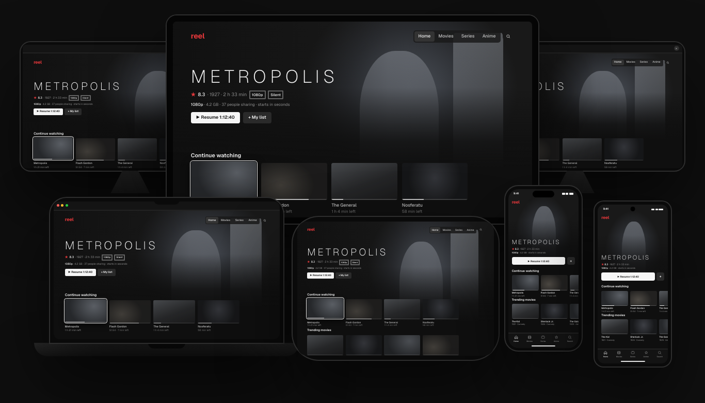

  

<h1 align="center">reel</h1>

  <b>Pick a film. It plays in seconds.</b> 
  Films and series from torrents, on your TV, phone and computer.

  <a href="https://reel-site.fly.dev"><b>Website</b></a> ·
  <a href="https://github.com/exzos28/reel-releases/releases/latest"><b>Download</b></a>

  

- **Nothing to download first.** It fetches the start of a film and plays.
- **Your source.** It searches the Torznab source you enter. reel ships none.
- **Any format.** Every container, codec, audio and subtitle track.
- **No accounts.** Settings and progress stay on your device.

Samsung TV · Android and Android TV · macOS · Windows · Linux

[How it works](docs/how-it-works.md) · [Building](docs/building.md) ·
[Repository layout](docs/structure.md) · [Architecture](docs/architecture.md)

PolyForm Noncommercial 1.0.0: free for any noncommercial use ([licence](LICENSE), [notices](NOTICE)).
